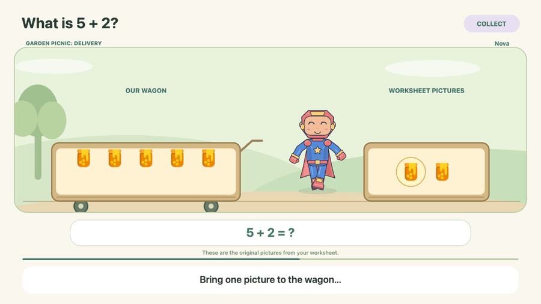
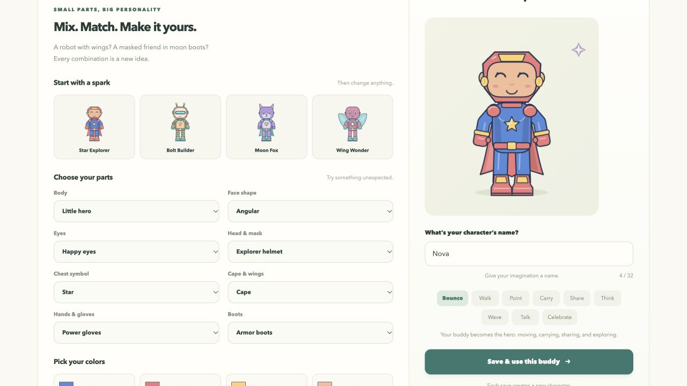
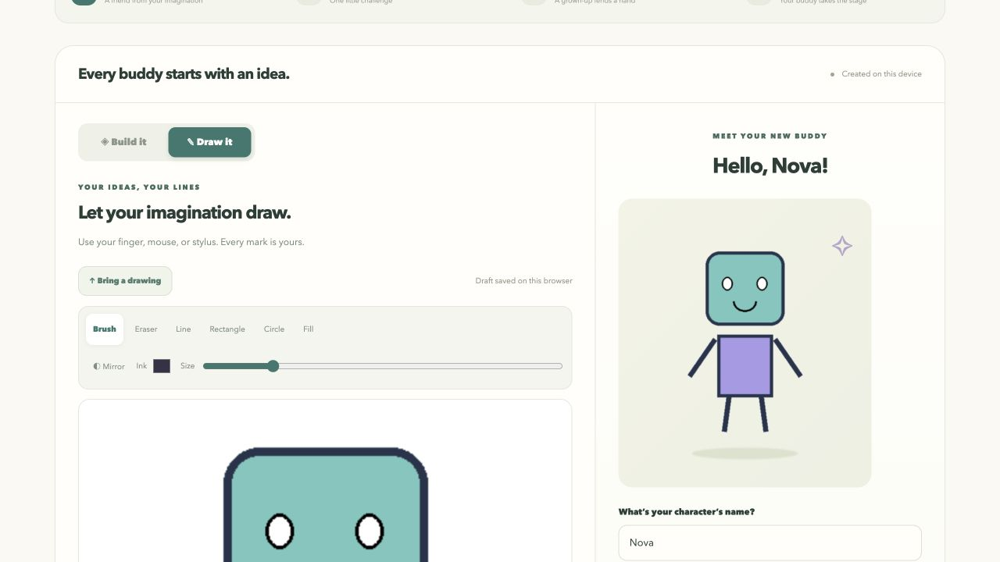
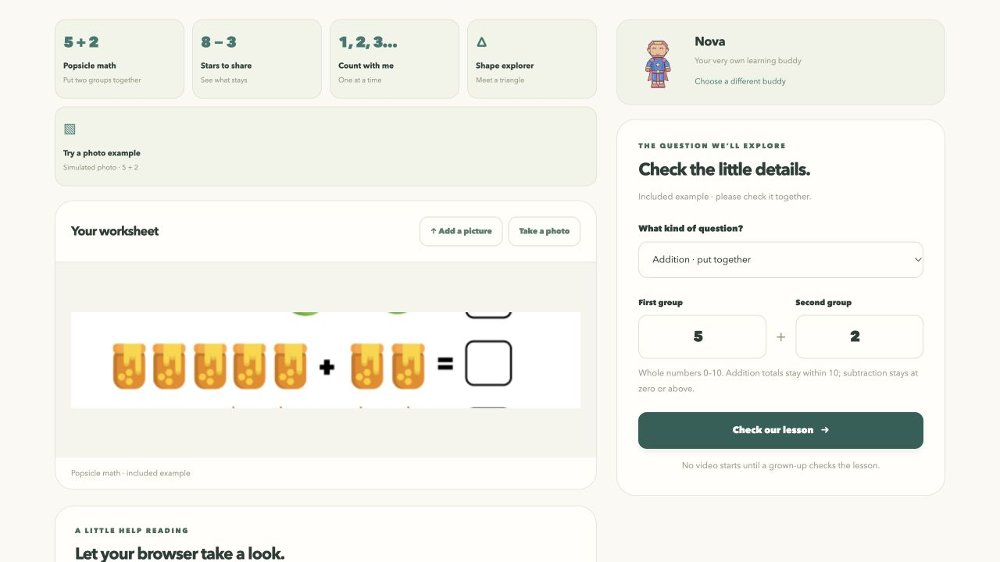
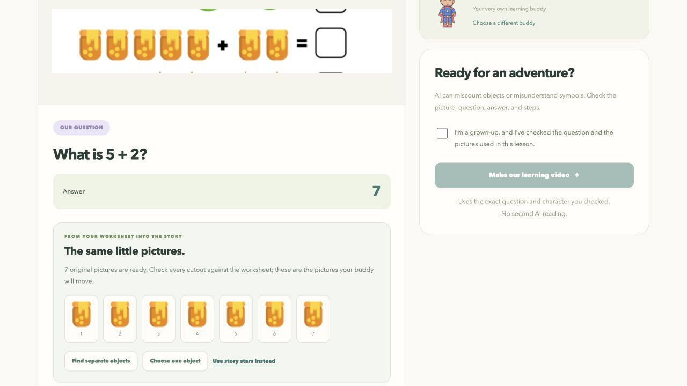

# My Lesson Buddy

**Turn a math question into a visual explanation starring a character a child creates.**

My Lesson Buddy explores a familiar moment in parent-guided K–2 practice: a child has the worksheet, but needs help seeing what the mathematics means. We turn a reviewed question into a story in which a character the child creates performs the mathematical actions.

[Try the live demo](https://my-lesson-buddy-studio.leftcloak4.chatgpt.site) · [Problem and approach](docs/PROJECT_STORY.md) · [Visual tour](docs/SHOWCASE.md) · [Run locally](docs/SETUP.md) · [Technical architecture](docs/ARCHITECTURE.md) · [Evaluation results](docs/EVALUATION.md)

## The problem we are exploring

When a child gets stuck, the caregiver may need to interpret the page, choose an explanation, and guide another attempt. A worksheet can show five popsicles and two more without making the change involved in addition obvious to the learner.

Our initial use case is **caregiver-supported practice at home**. We want to make a useful explanation easier to prepare while keeping the adult involved. How often families face this problem, how much time we could save, and whether they would pay are customer hypotheses we still need to test.

## Our approach

**The child's own buddy acts out a checked explanation using objects connected to the original question.**

| Design choice | How it addresses the problem |
| --- | --- |
| Keep the worksheet recognizable | Use reviewed source-object cutouts, so a popsicle question can stay a popsicle story. |
| Let the child create the actor | Draw or customize the buddy that carries, gives, points, and traces during the explanation. |
| Make each mathematical change visible | Preserve the starting group and move one item at a time, with counting tied to completed actions. |
| Check the question before the story | Compute the answer in code and require adult review of the interpretation and representation. |
| Offer different story settings | Change the world while preserving the reviewed question and mathematical steps. |

This combination is our product thesis. We have implemented the browser workflow; its effects on ownership, understanding, and repeat use remain to be tested. The [project story](docs/PROJECT_STORY.md) explains the educational rationale, the longer-term feedback loop, and what success would mean.

## See it in action

*An eight-second silent excerpt from a recorded lesson: the character moves the worksheet's original popsicles. The live app provides narration. This authored example demonstrates the teaching flow, not automatic-reading accuracy.*

<table>
  <tr>
    <td width="50%"><strong>1. Build a buddy</strong>  Choose parts, colors, clothes, and accessories.</td>
    <td width="50%"><strong>2. Draw or import one</strong>  The canvas shown here uses the project's demo robot drawing.</td>
  </tr>
  <tr>
    <td><strong>3. Bring a question</strong>  Use a picture, an included example, or manual numbers.</td>
    <td><strong>4. Check before teaching</strong>  Review the question, answer, and exact objects the buddy will move.</td>
  </tr>
</table>

[Explore the full visual tour](docs/SHOWCASE.md) for lesson playback, four story worlds, photo preparation, local Python apps, and the worksheet research corpus.

## The learning experience

**Create a buddy → Bring a question → Check together → Watch the explanation**

1. **Create.** Draw an original character, or customize a character using modular parts, colors, clothes, and accessories.
2. **Bring a question.** Upload or photograph one worksheet exercise, choose an example, or enter the numbers manually. Automatic reading is optional and experimental.
3. **Check together.** An adult confirms the operation, quantities, answer, character, and visual representation.
4. **Watch and explore.** The character performs the mathematical actions in a narrated story. Children can replay the explanation or download the video.

For `4 + 3`, a buddy can carry three objects into an existing group of four, then count the seven objects together. Worksheet pictures can become the story props when they can be separated clearly. Pure number questions can use story stars to make the quantities visible.

## What works today

| Lesson | Current teaching range |
| --- | --- |
| Addition | Whole numbers from 0–10; the total is at most 10. |
| Subtraction | Whole numbers from 0–10; the result cannot be negative. |
| Counting | Quantities from 0–10. |
| Basic shapes | Name a circle, triangle, square, or rectangle, or count its straight sides. |

Broader worksheet topics are represented in the research dataset. Teaching regrouping, two-digit arithmetic, fractions, time, money, and multiplication/division requires additional lesson logic. A successful reading alone does not add a new teaching capability.

## Choose how to try it

| Your goal | Start here | Requirements |
| --- | --- | --- |
| Try the full experience | [Live website](https://my-lesson-buddy-studio.leftcloak4.chatgpt.site) | A compatible browser; no local server or API key. |
| Develop the combined website | [Browser development guide](web_site/README.md) | Node/npm and a local static server. |
| Run the Python lesson app | [Local setup](docs/SETUP.md#python-lesson-app-on-an-apple-silicon-mac) | An Apple silicon Mac, Python, FFmpeg, and cached vision weights for picture reading. |
| Work on character creation | [Character Studio](character_studio/README.md) | Python dependencies; no vision model required. |
| Generate a video from text | [Command-line lesson guide](lesson_video/README.md) | Python, FFmpeg, and an installed macOS voice. |
| Inspect reading quality | [Evaluation summary](docs/EVALUATION.md) | Results can be read on GitHub; interactive HTML reports open after download. |

The hosted website and the Python apps are separate implementations. Their readers, narration, storage, and video formats differ; see the [architecture guide](docs/ARCHITECTURE.md).

## Technical approach

The pipeline reads a question, validates a bounded lesson, computes the answer in code, and freezes the reviewed plan. The renderer then follows authored actions and narration timing. A model does not invent the mathematical answer or freely generate the film.

| Component | Implementation |
| --- | --- |
| Hosted picture reader | Experimental SmolVLM-256M through Transformers.js and WebGPU. |
| Local Mac picture reader | Cached Qwen3-VL-4B-Instruct-4bit through MLX-VLM. |
| Math and story planning | Validated quantities, computed answers, and deterministic scene actions. |
| Hosted narration | Prerecorded Kokoro-82M narration with measured scene timing. |
| Video export | Browser Canvas/MediaRecorder, or the Python renderer with FFmpeg. |

Read [architecture and review boundaries](docs/ARCHITECTURE.md) or the [browser reader's technical notes](web_site/READER_NOTES.md) for implementation details.

## Evaluation: evidence and limits

The reading lab contains **100 web-source task images across 22 topics**, plus **30 synthetic variants of 10 development questions**. A separate object-count audit reuses eight pictures with nine labeled target groups.

| Local broad-reading measure | Strict output | After limited format normalization |
| --- | --- | --- |
| Main-topic label match | 59 / 100 | 67 / 100 |
| Complete equation transcription | 16 / 26 | 18 / 26 |
| Visible object category and count match | 2 / 9 targets | 7 / 9 targets |

Normalization reuses the original responses; it changes allowed output formatting and does not rerun the model or supply answers. These are separate checks, not an overall recognition score. They do not measure the hosted browser reader. The corpus contains **zero real phone photographs**, and its labels still need independent teacher review.

[Read the findings and failure cases](docs/EVALUATION.md) · [Reproduce the benchmark](worksheet_benchmark/README.md)

## Repository map

| Path | Purpose |
| --- | --- |
| [`web_site/`](web_site/README.md) | Combined browser app, story engine, narration assets, and browser tests. |
| [`character_studio/`](character_studio/README.md) | Local drawing canvas, parts builder, character library, and package import/export. |
| [`lesson_video/`](lesson_video/README.md) | Python reading, planning, narration, rendering, and local web service. |
| [`worksheet_benchmark/`](worksheet_benchmark/README.md) | Dataset construction, model adapters, scoring, and report generation. |
| [`benchmarks/worksheet_v1/`](benchmarks/worksheet_v1/) | Source-backed images, labels, provenance, and review catalogue. |
| [`output/worksheet_benchmark/`](output/worksheet_benchmark/) | Saved baseline predictions, metrics, and HTML reports. |
| [`tests/`](tests/) and [`examples/`](examples/) | Python checks and demonstration fixtures. |
| [`docs/`](docs/) | Setup, architecture, evaluation, and optional integration guides. |

## Next development priorities

1. Improve missing-context detection and the consistency of reader outputs.
2. Independently review labels and add genuine phone photos and handwriting.
3. Extend teaching scenes with ten-frames, making ten, and place-value representations.
4. Connect the planned teaching/verification/correction branches to the reviewed worksheet and created character.
5. Add another attempt and a new transfer problem, then evaluate understanding, adult support, and repeat use.

New uploads do not automatically retrain the models. Fine-tuning and broader lesson support are separate development steps.

For publication scope and licensing, see [public repository contents](PUBLICATION.md) and [third-party notices](THIRD_PARTY_NOTICES.md). The worksheet corpus retains its source-specific noncommercial academic-use terms.
