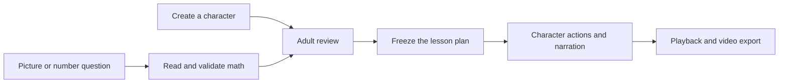

# Architecture and review boundaries

[Project overview](../README.md) · [Problem and approach](PROJECT_STORY.md) · [Setup](SETUP.md) · [Evaluation](EVALUATION.md)

My Lesson Buddy has two application runtimes and a separate evaluation lab. Each application turns a reviewed, supported question into an authored sequence of teaching actions.

The product goal is a usable explanation for caregiver-supported practice. Keeping source objects recognizable, making the character perform the operation, and freezing reviewed quantities are the technical choices behind that goal. The [project story](PROJECT_STORY.md) explains the intended value and the evidence still needed.

## The common lesson pipeline

The reader proposes an interpretation. Application code checks its structure and allowed values, computes the answer, and prepares the review. Rendering uses the approved snapshot rather than rereading the picture or asking a model to invent scene facts.

This diagram describes the interactive applications. The command-line generator is a direct developer interface; use its `--inspect-only` picture mode to review evidence before a full render.

## Runtime comparison

| Concern | Hosted browser app | Local Python apps |
| --- | --- | --- |
| Entry point | `web_site/dist/index.html` | `python -m lesson_video.web`; `python -m character_studio` |
| Picture reader | Experimental SmolVLM-256M, Transformers.js, WebGPU | Cached Qwen3-VL 4B, MLX-VLM |
| Calculation | Validated JavaScript lesson plan | Validated Python lesson plan |
| Rendering | Canvas scene state and character anchors | Python image renderer and FFmpeg |
| Narration | Build-time Kokoro clips and a measured audio timeline | Installed macOS `say` voice in the default lesson pipeline |
| Export | MP4 when the browser supports it; otherwise WebM | MP4 |
| Persistence | Browser-local drafts and character collection | Local character library and per-job storage |
| Server role | Serve static app, runtime, and audio assets | Streamlit screen plus a localhost Flask service |

The two readers have different sizes and operating environments. The current evaluations are not a matched comparison between them.

## Characters and mathematical actions

| Lesson | Action | Invariant |
| --- | --- | --- |
| Addition | Collect and deliver new objects to the starting group | Each object moves once; the final group contains the sum. |
| Subtraction | Carry objects from the starting group to a separate recipient | The remainder and delivered objects stay distinct. |
| Counting | Visit and point to one object at a time | One count is associated with each item. |
| Shapes | Trace the requested outline or inspect the shape | A circle receives no invented straight sides. |

Browser story state partitions stable object IDs into home, source, moving, and delivered sets. Speech offsets place count words after the corresponding action. The same frozen timing plan drives playback, seeking, and recording.

Parts characters have defined joints and hand anchors. Drawn characters move intact with an anchor beside their visible artwork. Automatic drawing rigs and sound-by-sound lip sync are future work.

## Connecting worksheet pictures to the story

1. **Prepare the photo.** Detect the paper, correct perspective, and reduce uneven shadows where possible. Retain the original and allow corner adjustment or restoration.
2. **Establish the question.** Use the experimental reader or manual entry, then check the operation and quantities.
3. **Choose the representation.** Preview automatically separated cutouts, manually crop one complete object to repeat, or explicitly select story stars.
4. **Approve the plan.** Freeze the question, character, representation, and presentation settings before rendering.

Object extraction uses conservative image processing; it is not a general learned segmenter. It can decline ambiguous artwork even when a question is otherwise readable. Pure numeric questions can use story stars without extracting picture objects. Ten-frames, regrouping, and broader mathematical representations need additional teaching logic.

## Boundaries implemented today

- **Untrusted model output:** validate schemas, supported ranges, operations, and supplied answers. Compute answers in application code.
- **Adult review:** require comparison with the source question before preparing a video. Validation cannot independently prove that the model counted the image correctly.
- **Stable lesson snapshots:** isolate reviewed inputs from later character, question, or library edits.
- **Browser privacy:** keep worksheet and character pixels on the device in the hosted workflow. Public runtime/model downloads still make network requests.
- **Local service isolation:** bind the Python service to localhost, serialize reading/rendering jobs, and use per-job access tokens.
- **Explicit external integration:** Gemini stays disabled unless configured. Its optional requests send the selected image to Google after the relevant review/enablement steps.

These controls do not establish comprehensive semantic content moderation, classroom readiness, or production authentication. The Python service has no child accounts or durable cloud work queue. Broader moderation, real-photo evaluation, independent teacher review, and child usability studies remain development work.

## Where to extend the implementation

| Area | Main files |
| --- | --- |
| Browser math and story state | `web_site/dist/modules/lesson.js`, `story.js`, `adventures.js` |
| Browser character and picture tools | `web_site/dist/modules/character.js`, `picture.js`, `objects.js`, `photo.js` |
| Browser inference contract | `web_site/dist/modules/reader.js`, `vision-worker.js`; [reader notes](../web_site/READER_NOTES.md) |
| Python planning and rendering | `lesson_video/planner.py`, `generate.py`, `visuals.py`, `characters.py` |
| Local frontend/backend | `streamlit_app.py`, `lesson_video/web_api.py`, `web_pipeline.py`, `job_store.py` |
| Character library and animation | `character_studio/assets.py`, `parts.py`, `motion.py`, `static/` |
| Broad reading evaluation | `worksheet_benchmark/`; [reproduction guide](../worksheet_benchmark/README.md) |
