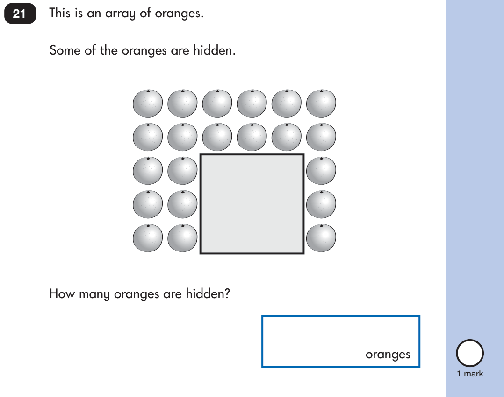

# What has been tested

[Project overview](../README.md) · [Architecture](ARCHITECTURE.md) · [Reproduce the benchmark](../worksheet_benchmark/README.md)

Evaluation covers different questions: whether the software preserves a lesson, whether a model reads a worksheet, and whether the product helps children learn. Results in one category do not establish the others.

## Automated software checks

At the initial public repository publication, the browser suite passed **131 tests**. The Python suite ran **250 tests**, completed successfully, and skipped four. The browser build also verified 317 narration assets. These counts describe that run; use the commands below for the current checkout.

```sh
# Repository root, in the Python app environment
python -m unittest discover -s tests -q

# Browser app
cd web_site
npm test
npm run build
```

Checks cover arithmetic validation, object conservation, character actions, scene timing, photo-processing boundaries, imports, job snapshots, and error handling. Mocked model/provider tests verify interfaces rather than recognition or live provider access. No learning-outcomes study has been completed.

## Broad worksheet-reading corpus

| Corpus property | Coverage |
| --- | --- |
| Primary images | 100 unique source task images from 23 PDFs. |
| Sources | 80 England KS1 test/practice items; 20 US Kindergarten/Grade 1/Grade 2 Illustrative Mathematics tasks. |
| Content | 22 curator-assigned topics, including money, time, geometry, fractions, data, place value, and arithmetic. |
| Representations | Equations, cartoons, colored drawings, button photos, clocks, coins, diagrams, tables, charts, and activity instructions. |
| Split | 67 development / 33 test; whole source PDFs stay in one split. |
| Extra stress images | 30 synthetic variants of 10 development arithmetic questions. |
| Visible-object audit | Eight reused source pictures; nine labeled target categories. |
| Real phone photos | **0**. |
| Independent teacher review | Pending. |

Native grade systems retain their original definitions. This convenience sample comes from two publishers; public tasks may have appeared in model pretraining. It is not a representative classroom sample or a contamination-free benchmark. The first baseline evaluated both splits, so a fresh holdout is needed after development based on these results.

## Local model baseline

The experimental broad-reading probe uses locally cached **Qwen3-VL-4B-Instruct-4bit**. It receives an image and a fixed generic prompt; labels, source filenames, grades, and answer references stay outside inference. This probe is separate from the bounded application reader.

| Measure | Strict output | Limited format normalization | Interpretation |
| --- | --- | --- | --- |
| Main-topic label match | 59 / 100 | 67 / 100 | Agreement with one curator-assigned topic. |
| Complete equation transcription | 16 / 26 | 18 / 26 | Preserve the printed operands, operation, and blank position. |
| Invalid-format readings | 23 / 100 | 14 / 100 | Keep interface failures visible. |
| Visible object category + count match | 2 / 9 targets | 7 / 9 targets | Small, partial category audit across eight pictures. |
| Missing spoken-context detection | 0 / 1 | 0 / 1 | One deliberately incomplete question control. |

Normalization reuses the same raw responses. It only converts supported number/operator formatting or wraps a singleton object record into a list. It does not provide answers, repair invalid JSON, invent omitted categories, or run the model again. Strict outputs remain available alongside this diagnostic.

**Concrete failure cases:** the counting probe returned 16 for 21 visible oranges; it omitted a star sticker target. The reading probe guessed a geometry task for a ladder illustration whose spoken question was absent. These are useful targets for improvement, not evidence that every mismatched label is a model error.

<details>
<summary><strong>Inspect a real counting failure</strong></summary>



<p>The visible-object probe measures the drawn oranges: the curated target is 21, and the model returned 16. The printed worksheet asks about hidden oranges, which is a separate reasoning task. This is source data from the benchmark, with its <a href="../benchmarks/worksheet_v1/ATTRIBUTION.txt">source attribution</a> retained.</p>

</details>

Topic matching does not establish complete task understanding. The separate printed-number recall targets are partial PDF-text targets, not object-count accuracy. Open-ended answers, clock interpretation, diagram relationships, and teaching quality still need human scoring.

## Synthetic conditions, paired to the same questions

| Condition | Strict equation transcription | After format normalization |
| --- | --- | --- |
| The same 10 original questions | 6 / 10 | 7 / 10 |
| Simulated handwriting font | 9 / 10 | 10 / 10 |
| Synthetic perspective | 7 / 10 | 9 / 10 |
| Synthetic shadow/blur | 9 / 10 | 10 / 10 |

These are repeated views of 10 development questions, not 30 new independent questions. The handwriting is rendered, not written by children. Higher scores on a transformed view do not establish that blur or shadows are harmless. Do not compare these arithmetic-only rates with the broader 100-image topic distribution as though the groups were equivalent.

## Browser reader and earlier checks

The hosted reader uses the separate SmolVLM-256M model. In a recorded November 2, 2026 WebGPU smoke test on the included 5+2 popsicle example, three prompt formats produced malformed or irrelevant text and no valid automatic reading. The app rejected those outputs and retained manual entry. See the [browser reader notes](../web_site/READER_NOTES.md#live-browser-smoke-test-november-2-2026).

The local app also has an earlier seven-image development smoke evaluation. The legacy rule-based reader has 16 synthetic fixtures. These test different implementations and scopes; none should be presented as the 100-image broad benchmark or a real-phone accuracy study.

## Inspect the evidence

GitHub displays HTML files as source. After cloning or downloading the repository, open the reports in a browser.

| Evidence | File |
| --- | --- |
| Interactive results overview | [`output/worksheet_benchmark/index.html`](../output/worksheet_benchmark/index.html) |
| Source images and labels | [`benchmarks/worksheet_v1/index.html`](../benchmarks/worksheet_v1/index.html) |
| Strict per-case results | [`qwen_reading_v1/metrics.json`](../output/worksheet_benchmark/qwen_reading_v1/metrics.json) |
| Normalized diagnostic | [`qwen_reading_v1_normalized/metrics.json`](../output/worksheet_benchmark/qwen_reading_v1_normalized/metrics.json) |
| Visible-object audit | [`qwen_object_counts_v1_normalized/metrics.json`](../output/worksheet_benchmark/qwen_object_counts_v1_normalized/metrics.json) |
| Paired stress results | [`paired_robustness.csv`](../output/worksheet_benchmark/paired_robustness.csv) |

The next evidence priorities are independent annotation review, more complete diagram/count labels, genuine consented phone photos, and a fresh held-out set. Reading improvements should be evaluated separately from broader teaching support and child learning outcomes.
