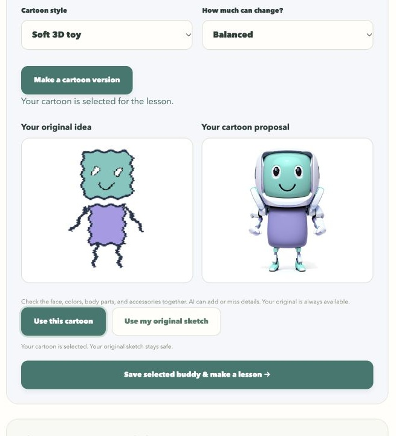

# Local sketch-to-cartoon makeover

[Project overview](../README.md) · [Browser guide](../web_site/README.md) · [Architecture](ARCHITECTURE.md)

This optional local studio turns a rough drawing into a cartoon proposal, keeps the original available, and lets the child choose which version appears in a reviewed lesson. It uses pretrained diffusion models, not a paid image API. Model inference and drawing pixels stay on the computer running the local studio.



*Development demonstration using simulated roughness, not a real child drawing.*

## Start on Ryan's configured Mac

Open **Start Local Cartoon Studio.command** in the project folder. It starts the app in the background and opens **http://127.0.0.1:8613/**. The terminal can be closed after startup. **Stop Local Cartoon Studio.command** stops the launcher-owned service. The Mac must remain awake while generating a character or recording a video.

The model environment and approximately 3.5 GB of weights are already configured in this project copy. They are ignored by Git and are not part of the shared website or repository.

## Set up another computer

Install [uv](https://docs.astral.sh/uv/getting-started/installation/), then open **Setup Local Cartoon Studio.command** on a Mac. The setup downloads a Python runtime if necessary, installs pinned dependencies in `.venv-cartoon`, and downloads the pinned model files. It does not request an API key or start paid inference.

For VS Code or another supported computer, run these commands from the repository root:

```sh
uv venv .venv-cartoon --python 3.12
uv pip install --python .venv-cartoon/bin/python -r requirements-cartoon.lock.txt
.venv-cartoon/bin/python -m lesson_video.cartoon_setup --download
.venv-cartoon/bin/python -m lesson_video.cartoon_web --port 8613
```

The foreground command stops with Control+C. On macOS the separate launcher runs the service in the background:

```sh
.venv-cartoon/bin/python -m lesson_video.cartoon_launcher
.venv-cartoon/bin/python -m lesson_video.cartoon_launcher --stop
```

The tested development computer is an Apple M4 Pro with 24 GB memory, using PyTorch MPS. CUDA and CPU paths are selected when available, but have not received the same end-to-end device test. CPU generation can be much slower. This is a loopback development service, not a public inference server.

## Try the complete experience

1. Open the local studio and choose **Draw it**.
2. Draw or import a picture. `examples/characters/rough_robot_demo.png` is a labeled simulated-roughness development fixture, not a real child's drawing.
3. In **Cartoon makeover**, describe the colors and features to keep. Try “Turquoise square robot head with white oval eyes and a smile, purple body, two dark arms and two dark legs.”
4. Choose **Soft 3D toy**, **Storybook cartoon**, or **Comic cartoon**, plus a change level. **Balanced** is the tested starting point; **Gentle** keeps stronger contour guidance.
5. Generate a proposal. Compare the face, colors, limbs, clothing, and accessories. The original remains selected until the child chooses **Use this cartoon**.
6. Click **Save selected buddy & make a lesson**, choose a question, and review it with an adult. The selected character participates in the existing narrated story and video export.

The original, proposal, selected version, and settings can be restored from this browser's draft when storage permits. New marks invalidate the previous comparison. Saved characters remain independent. Export a `.character.zip` from the collection to keep a copy or import it into the [shared website](https://my-lesson-buddy-studio.leftcloak4.chatgpt.site).

The shared website does not run this larger diffusion model or send pictures to a visitor's localhost service. It shows local setup guidance and supports exported character packages. Its separate Qwen text-to-parts and Swin2SR detail-polish features continue to run inside the browser.

## How the redraw stays connected to the sketch

| Mechanism | Implementation and limit |
| --- | --- |
| Source conditioning | Original RGB image initializes img2img, retaining spatial color information. |
| Shape guidance | Smoothed Canny edges guide ControlNet. Change level adjusts how closely the model follows them. |
| Learned redraw | DreamShaper 8 / Stable Diffusion 1.5, 30 scheduled steps, fixed style presets and a bounded feature hint. |
| Palette alignment | Generated chromatic pixels align to the source's dominant hues and saturation; generated shading and neutral colors remain. This is not pixel-exact color preservation. |
| Safety check | The pretrained output safety checker remains enabled. Its CLIP encoder runs on CPU in float32. A rejected result is not released. |
| Drift checks | Foreground coverage, approximate alignment, and border clipping checks can reject large changes. These are image heuristics, not semantic identity scores. |
| Child approval | Original and proposal are separate. The child explicitly selects the version; an adult still reviews the lesson. |
| Animation | The saved PNG uses the existing whole-artwork motion and visible-ink prop anchor. No automatic limb rig is inferred. |

The model can add details or alter a feature. The checks cannot verify every limb, expression, meaning, or accessory, and the safety checker is not comprehensive child-content screening. Less change, a clearer description, another proposal, or keeping the original remain available. There is no measured child-drawing accuracy or learning-outcome claim.

## Reproducible model configuration

| Component | Repository / pinned revision |
| --- | --- |
| Base model and safety checker | `Lykon/dreamshaper-8` / `a7e52b98680b1ba8ff7bce97c7f9f2e2e5337917` |
| ControlNet | `lllyasviel/control_v11p_sd15_canny` / `115a470d547982438f70198e353a921996e2e819` |
| Weight download | 3,463,219,720 bytes, plus small config/tokenizer files; fp16 safetensors only. |
| Execution precision | Float32, avoiding a half-precision NaN observed on the tested MPS configuration. |
| Working image | 384 × 512; final drawing character 600 × 800 RGBA. |
| Scheduler | DPM-Solver++, Karras sigmas, 30 scheduled steps. |
| Change levels | Gentle: strength .65 / control .75; Balanced: .80 / .40; Creative: .85 / .30. |
| Palette | Up to six source chromatic clusters; source white paper does not dominate the palette. |
| Request lifecycle | One job at a time, source SHA-256 binding, random job token, cancellation checks, eight-minute inference deadline. |

Ordinary startup and inference use `local_files_only=True`; downloads happen only during explicit setup. Weights live in `.cache/cartoon_models`. The service binds to loopback, checks the Host and Origin, requires a custom mutation header, and protects job reads with a per-job bearer token. It adds no cross-origin access. Temporary job data stays in memory, with bounded job retention; drafts and saved character packages use the existing browser storage.

Primary references: [DreamShaper model and license](https://huggingface.co/Lykon/dreamshaper-8), [ControlNet Canny model](https://huggingface.co/lllyasviel/control_v11p_sd15_canny), [Diffusers ControlNet img2img API](https://huggingface.co/docs/diffusers/api/pipelines/controlnet), [Apple silicon inference](https://huggingface.co/docs/diffusers/optimization/mps). Models are downloaded separately under their published licenses.

## Verification

Run the offline contract suites without generating images:

```sh
.venv-cartoon/bin/python -m unittest tests.test_cartoon_makeover -q
cd web_site
npm test
```

Tests cover bounded inputs, palette processing, drift rejection, retained white details, safety rejection, cancellation, source hashes, same-origin rules, job authorization, no public-site localhost probing, and stale-result prevention. Mock jobs test service/client behavior; actual-model browser demonstrations are separate development evidence. The rough fixture and generated example have not been evaluated by children or independent teachers.
