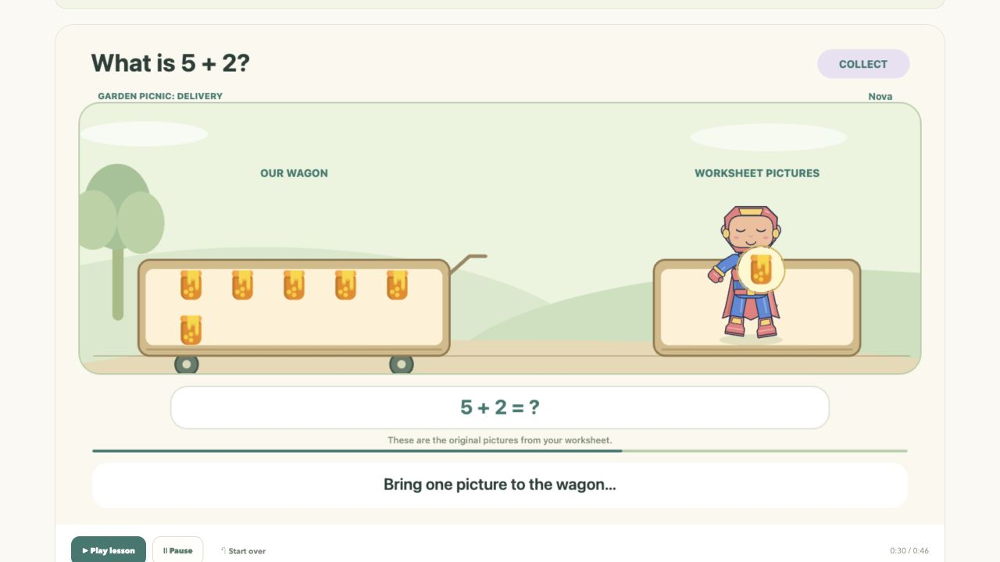

# The problem and our approach

[Project overview](../README.md) · [Visual tour](SHOWCASE.md) · [Architecture](ARCHITECTURE.md) · [Evidence](EVALUATION.md)

My Lesson Buddy starts with **caregiver-supported K–2 worksheet practice at home**. The child has a real question to work on. The adult wants an explanation that makes sense for that child and helps them attempt the next problem.

This framing carries forward the home-practice and learner-journey ideas developed in our capstone pitch. The deck used the working name *Snap & Learn*. *My Lesson Buddy* names the browser prototype and this repository.

## The customer problem

Consider a worksheet showing five popsicles plus two more. A child may recognize the pictures and numbers but need help understanding what addition changes. The caregiver then has a teaching task: interpret the page, choose words or objects that clarify it, and guide another attempt.

Our opportunity is to turn the assigned question into an explanation the caregiver can review and use with the child. The child and caregiver are both users; the caregiver is the initial potential buyer. We have not validated purchase intent, the frequency of this need, or the amount of preparation time saved.

Broader educational data motivates attention to mathematical foundations. The 2024 NAEP report states that 76% of US fourth-graders performed at or above NAEP Basic in mathematics, implying 24% below that threshold. This is grade-four context, not a K–2 measure, a market-size estimate, or evidence about our product. NAEP also calls for caution in interpreting its achievement levels. [Source: national NAEP mathematics results](https://www.nationsreportcard.gov/reports/mathematics/2024/g4_8/national-trends/?grade=4).

## Why this design

The IES What Works Clearinghouse elementary mathematics guide recommends systematic instruction, clear mathematical language, and carefully selected concrete or pictorial representations. These recommendations inform how we make a question visible. They do not validate our particular animation, personalization choices, or product. [Source: IES practice guide, March 2021](https://ies.ed.gov/ncee/wwc/PracticeGuide/26/i).

Our design combines familiar worksheet objects with a character the child helps create. The character's actions correspond to the operation: collecting adds to a group, giving changes what remains, and pointing associates a count with an object.

| Design decision | Reason for it | Evidence boundary |
| --- | --- | --- |
| Preserve the source artwork when possible | Help the learner connect the explanation to the question in front of them. | Original-cutout stories work for selected examples; broad recognition and extraction remain limited. |
| Let the child draw or build the buddy | Give the child a creative role in the learning experience. | The tools work; effects on participation or understanding need a child study. |
| Enact the mathematical change | Show how quantities change as the action happens. | Scene state and conservation checks support internal consistency, not proof that an image was read correctly. |
| Review before rendering | Give the adult a chance to correct the interpretation and inspect the representation. | Review is implemented; reduced adult effort remains a hypothesis. |
| Vary the setting around fixed mathematics | Offer different experiences while preserving the same checked steps. | Four worlds work; reduced visual fatigue has not been measured. |

This is the combination we are exploring. We do not claim to be the first or only product with personalized characters, animations, or worked explanations. Establishing a competitive advantage requires customer and market evidence beyond this prototype.

## Follow one question through the experience

The current browser demonstration uses the included 5+2 popsicle exercise:

1. A child draws a buddy or combines original parts. Demonstration captures use project sample artwork.
2. The family brings one question. Photo preparation can straighten the paper and reduce shadows; the original remains available.
3. An adult checks 5+2, the computed answer of seven, and the seven original cutouts. The included example has authored data; new pictures may need manual entry.
4. Five objects remain in the wagon. The buddy carries one more to it, then a second. Spoken counting follows the deliveries as the visible total reaches six and seven.
5. The family can pause, replay, or export the lesson. The reviewed character, question, and object identities stay fixed during playback.

The familiar picture, physical change, and equation remain connected throughout. Pure number questions can use story stars to represent their quantities within the current supported range.

## The longer-term learning loop

The pitch also proposed using the learner's submitted answer to choose the explanation, followed by a retry and a new problem. A separate team video notebook explored the answer branches. That work is a direction for integration, not a feature currently connected to this repository's browser flow.

| Learner input for 5+2 | Intended response | Status here |
| --- | --- | --- |
| No answer | Teach how the two groups combine. | The reviewed browser teaching story works. Automatic answer-based routing is pending. |
| Answer of 7 | Verify the result and the counting strategy. | Proposed integration with the team's answer-aware prototype. |
| Answer of 8 | Compare the submitted answer with the checked total and demonstrate the operation again. | Proposed integration; answer comparison alone does not diagnose the misconception. |
| After the explanation | Retry 5+2, explain what changed, then attempt 4+2. | Structured retry and transfer assessment are planned. |

The capstone also described a separate photo-to-storyboard service and age-adaptation research. Those components are not deployed as this public app's reader. Their reported studies are not pooled with this repository's local benchmark, which contains zero real phone photographs. The [architecture](ARCHITECTURE.md) and [evaluation](EVALUATION.md) guides describe what is reproducible here.

## What success would mean

Watching or exporting a video establishes a working experience. We want to test whether that experience helps a child explain the operation and use the idea on a different question.

| Hypothesis | What to measure |
| --- | --- |
| A caregiver can prepare useful support with less effort | Time to prepare a correct explanation, corrections needed, and adult prompts during practice. |
| Enacting the operation supports understanding | Compare an appropriate static explanation with the enacted version; ask the learner to explain the change and solve a new problem. |
| Creating the buddy adds value | Compare a created buddy with a provided buddy while holding the question and teaching sequence constant. |
| Answer-specific feedback helps another attempt | After integration, compare it with the same generic explanation and assess retry and transfer. |
| Families find the experience worth returning to | Observe repeat use and ask about willingness to pay; neither has been established. |

Teacher review, content screening, consent and retention procedures must precede a supervised child pilot. Current engineering checks and adult review do not establish comprehensive text/image moderation or regulatory certification. Success criteria should include mathematical correctness, comprehension, and the adult support required, rather than video completion alone.

## A short spoken introduction

> Imagine a child looking at five popsicles and two more on a worksheet. The caregiver knows the answer, but still needs a way to make the addition clear. My Lesson Buddy turns that reviewed question into a visual explanation performed by a character the child creates. The same popsicles become story props. Five stay in the wagon while the buddy brings two more, one at a time, and counting follows the action. Today, our browser prototype combines character creation, question review, and narrated playback. Our next goal is to connect answer-specific feedback with another attempt and a new problem. We want to learn whether this helps children explain the idea and makes practice easier to support. Those benefits are hypotheses we will test.
