# A visual tour of My Lesson Buddy

[Project overview](../README.md) · [Live demo](https://my-lesson-buddy-studio.leftcloak4.chatgpt.site) · [Setup](SETUP.md) · [Evaluation](EVALUATION.md)

These are actual application screens, recorded lesson frames, and project research fixtures. The fresh browser screenshots were captured on November 9, 2026. Reused development captures are identified below. Demo artwork is project sample content, not a private child's submission.

## 1. One website connects the experience

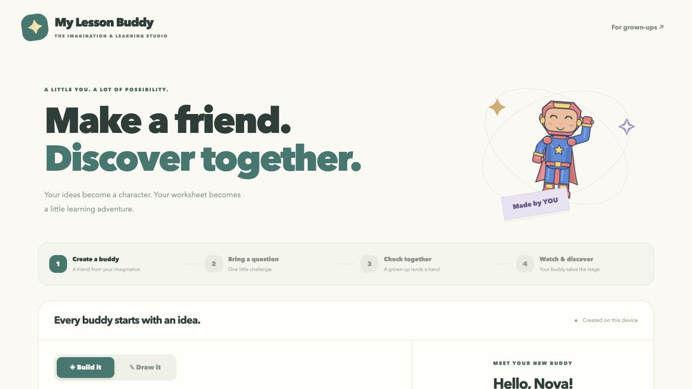

The hosted experience starts with character creation and continues through a reviewed lesson. Visitors do not need a local Python server or API key. [Open the studio](https://my-lesson-buddy-studio.leftcloak4.chatgpt.site).

## 2. Children can build or draw a character

### Mix original parts

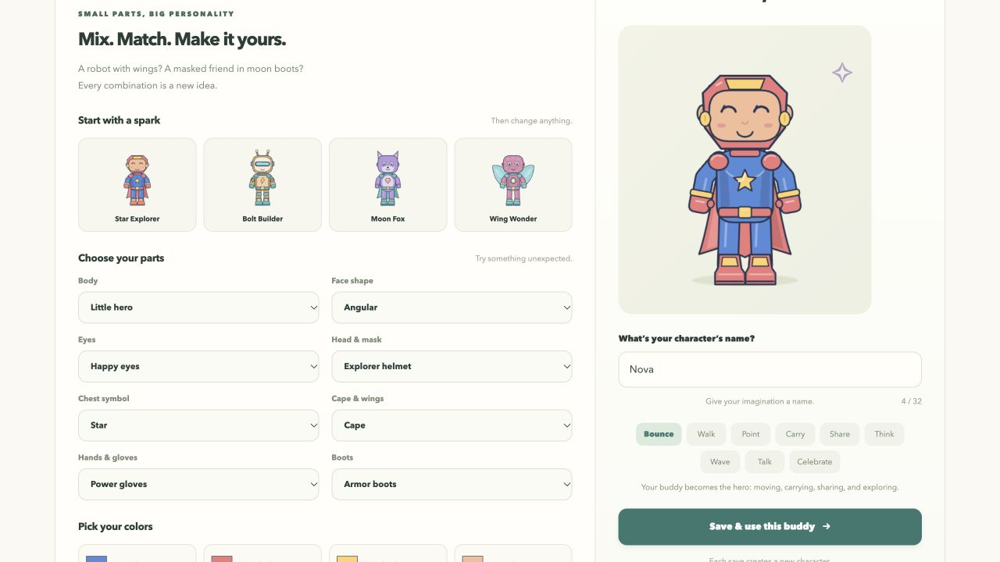

The builder combines original body types, headwear, symbols, capes/wings, gloves, boots, and colors. The screen shows the Nova demonstration character.

### Keep original artwork

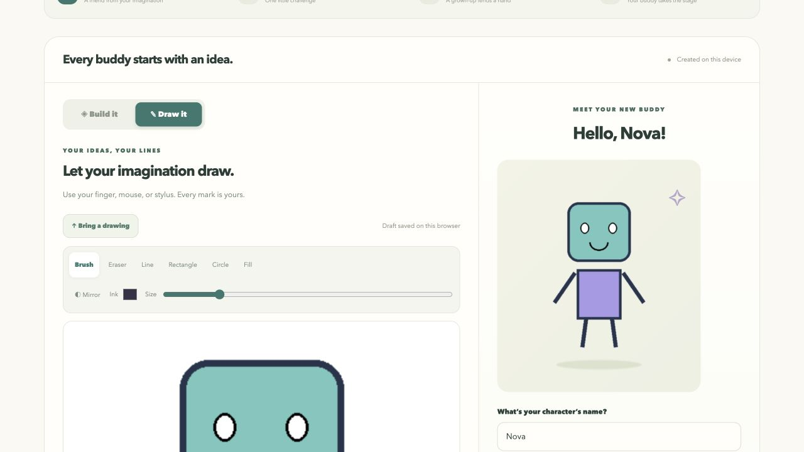

The drawing canvas supports freehand tools, shapes, fill, mirror, undo/redo, and image import. This screen uses `examples/characters/demo_robot_drawing.png`. It demonstrates importing and previewing original artwork; the robot was not drawn by a child during this capture.

## 3. Bring one question and check its details

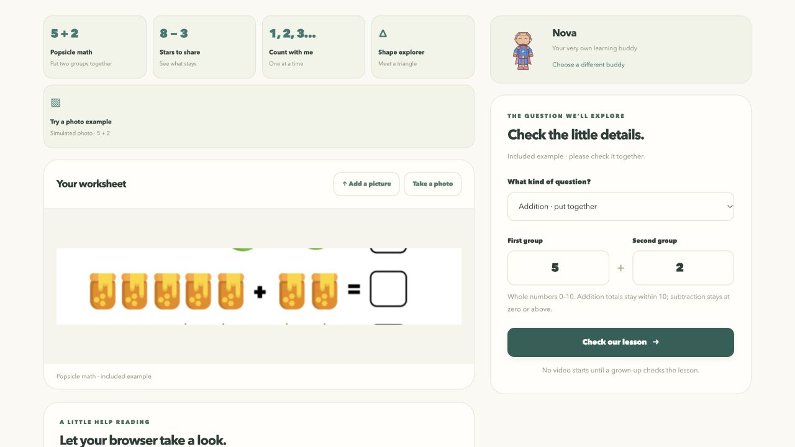

The included exercise has five popsicles plus two. Its question data is authored for the demo. A visitor can also enter quantities manually or try the optional experimental reader; this screenshot is not evidence of successful AI recognition.

## 4. Review the same objects that will appear in the story

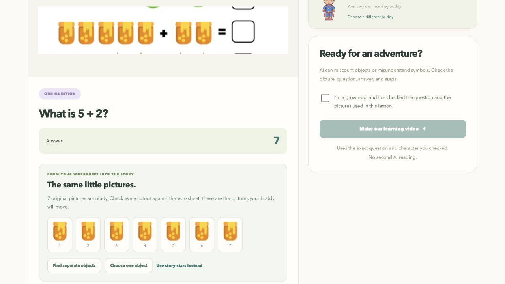

The adult review presents the computed answer and the seven original cutouts. The confirmation is deliberately unchecked in this screenshot. The story uses the selected artwork after approval; changing the source question clears the prior approval.

## 5. The character performs the mathematical action

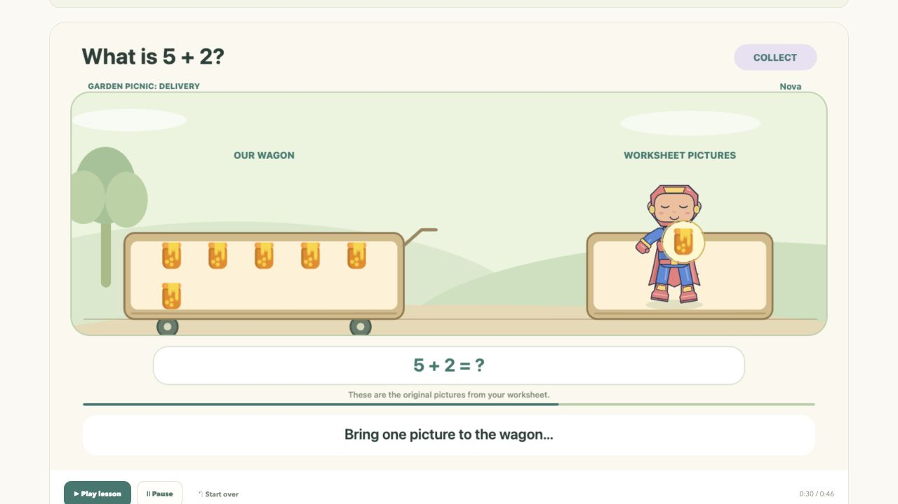

The character fetches, carries, and deposits the original objects. Stable object identities and a shared scene/audio timeline support replay and video export.

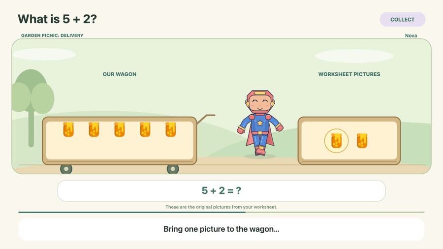

*Silent eight-second excerpt from a recorded browser lesson. The full app lesson includes narration. The animation illustrates the supported 5+2 lesson, not an unrestricted AI-generated film.*

## 6. Different questions can use different worlds

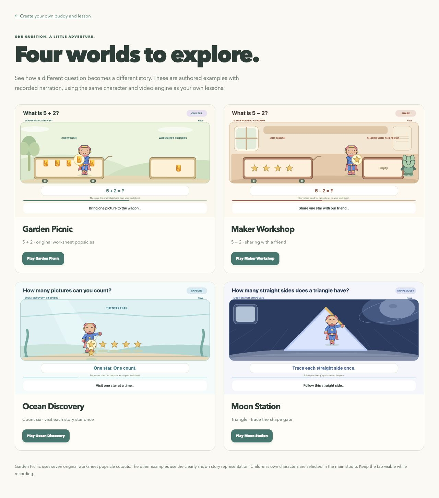

This reused project capture shows four authored gallery examples using the same story engine. Garden Picnic uses original popsicle cutouts; the other examples use explicitly identified story representations. The questions and mathematical steps remain controlled. [Try the four adventures](https://my-lesson-buddy-studio.leftcloak4.chatgpt.site/adventures.html).

## 7. Prepare a photograph before extracting objects

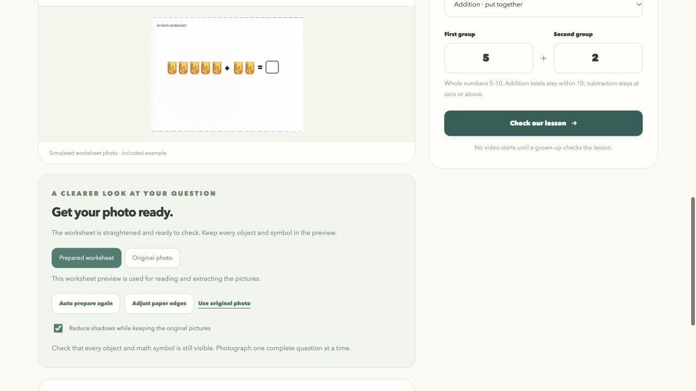

This reused development capture shows the preparation controls for the included **simulated photograph**. The original is retained for comparison or restoration.

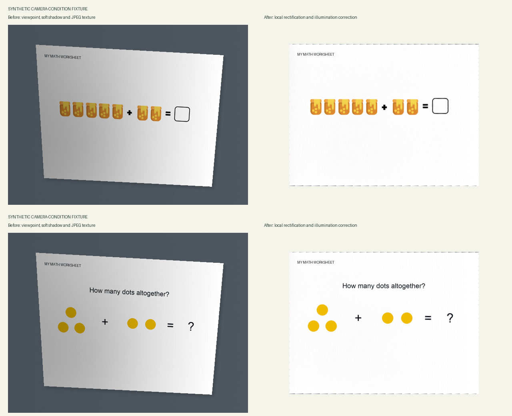

These are actual before/after outputs of the local processing pipeline on **synthetic camera-condition fixtures**. They demonstrate perspective and illumination correction, not measured real-phone performance. Read the [fixture description](../web_site/tests/fixtures/photo/README.md) and [evaluation limits](EVALUATION.md).

## 8. The research lab evaluates more varied worksheets

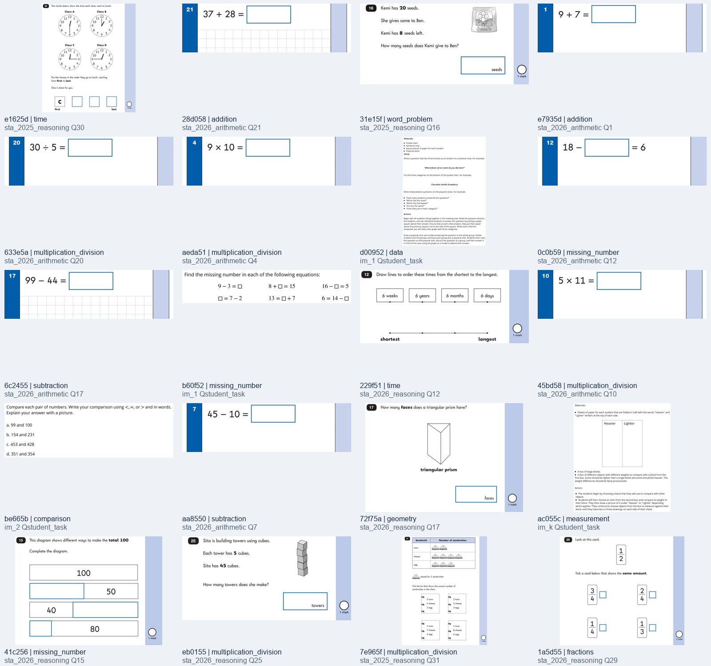

This contact sheet previews **20 of the 100 source task images**. The corpus spans 22 curator-assigned content topics, including topics the video renderer cannot yet teach. It contains zero real phone photographs. This is a data preview, not a screenshot of a model recognizing every question.

The separate [results guide](EVALUATION.md) reports strict and normalized baselines with their denominators. After downloading the repository, open `benchmarks/worksheet_v1/index.html` to inspect the actual image/label review tool and `output/worksheet_benchmark/index.html` to inspect the results overview.

Worksheet samples retain the [corpus attribution and source-specific terms](../benchmarks/worksheet_v1/ATTRIBUTION.txt).

## 9. Local Python tools remain available

The following are reused development captures of the separate Python interfaces. They are distinct from the hosted browser app.

### Connected lesson app

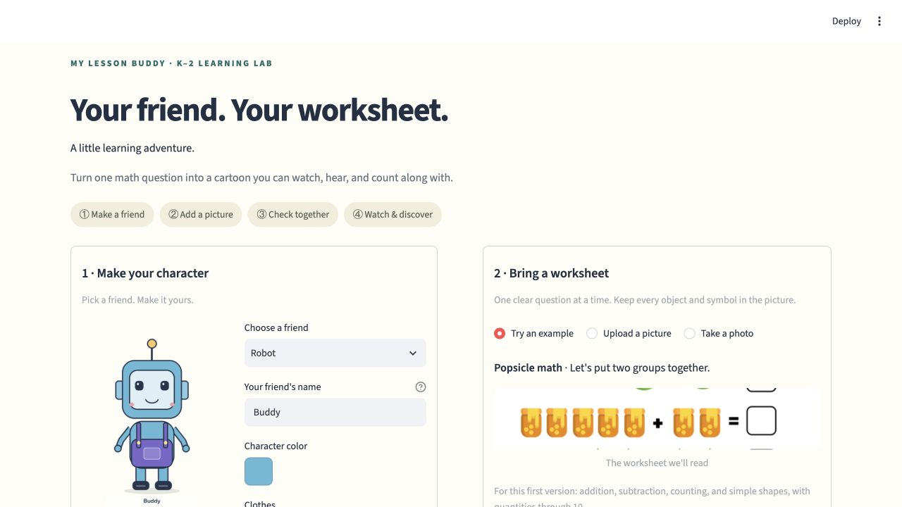

The local app connects a Streamlit screen to the Python lesson service. Picture reading uses cached Qwen weights on the tested Mac setup. [Run the Python lesson app](SETUP.md#python-lesson-app-on-an-apple-silicon-mac).

<strong>Show the standalone Python Character Studio</strong>

The local studio includes drawing, parts creation, a character collection, package export/import, and lesson handoff. This capture contains development demo characters.

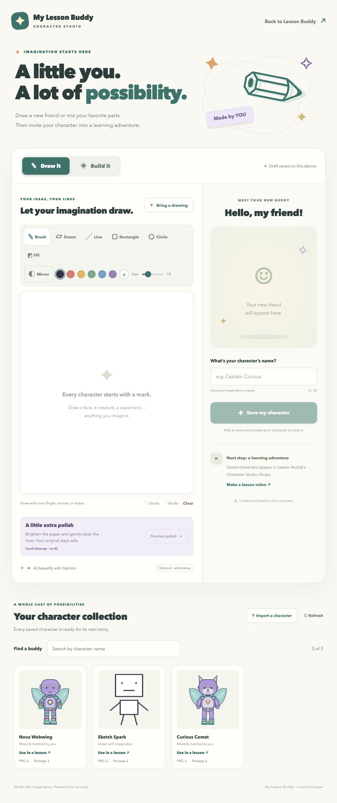

[Character Studio guide](../character_studio/README.md) · [Media source notes](images/README.md)
