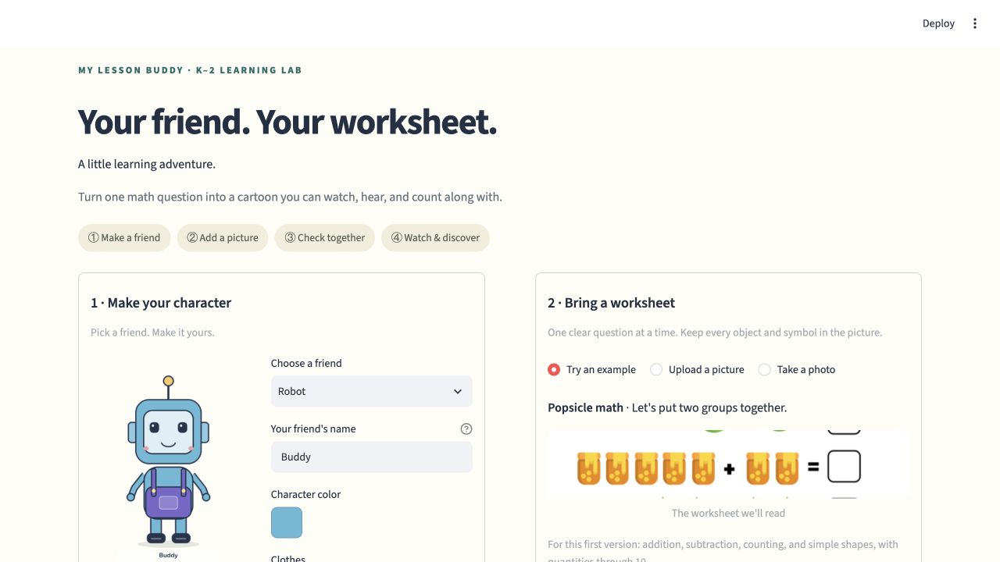

# Python lesson generator

[Project overview](../README.md) · [Install the local environment](../docs/SETUP.md) · [Architecture](../docs/ARCHITECTURE.md)

Read one supported worksheet question or text prompt, prepare an explanation, and render a narrated MP4. The Python app is the local Mac implementation; the [combined browser website](../web_site/README.md) uses a separate runtime.



*Development capture of the local Python interface using project demo content. The [visual tour](../docs/SHOWCASE.md) also shows the separate hosted browser flow.*

## Choose an entry point

| Goal | Command from the repository root |
| --- | --- |
| Connected lesson interface | `python -m lesson_video.web` |
| Picture to video | `python -m lesson_video --image PATH --out OUTPUT_FOLDER` |
| Inspect a picture reading | Add `--inspect-only` to the picture command. |
| Text to video | `python -m lesson_video "What is 4 + 3?" --out OUTPUT_FOLDER` |
| Text explanation only | `python -m lesson_video.explain "What is 4 + 3?" --out OUTPUT_FOLDER` |

Activate the environment for the chosen route first. Picture reading uses cached Qwen3-VL 4B weights; text prompts use bounded patterns and need no vision model. The default video narration uses macOS `say`; FFmpeg and ffprobe are required for rendering.

## Connected app workflow

```sh
source .venv/bin/activate
python -m lesson_video.web
```

Open **http://127.0.0.1:8501/**. The launcher starts the Streamlit screen and Flask lesson service together.

1. Choose/customize a character, or select **Studio library** for a saved drawing or parts character.
2. Choose an example, upload a picture, or use the camera. Keep one complete exercise visible.
3. Click **Read my picture** and inspect the proposed question.
4. An adult checks the quantities, operation, answer, and script, then confirms and clicks **Make my video**.
5. Watch the explanation or download the MP4.

Keep the page and terminal open until the job finishes. **Control+C** stops both services. Use `--port 8502 --api-port 5002` to select other ports. Refreshing the screen may lose its active job link; the current interface has no history/recovery page. An incorrect reading needs a new reading, rather than an in-place interpretation editor.

Each job snapshots its picture, character, design, and reviewed plan. Later library edits do not silently replace the reviewed character. Jobs run serially. Uploaded pictures stay in `.cache/web_jobs/`; logs are in `output/web_prototype/`. Remove local artifacts when no longer needed.

## Picture example

The command line renders directly and has no interactive adult-confirmation checkbox. For a new worksheet, use the inspection command below first and compare its evidence with the picture.

```sh
python -m lesson_video --image examples/worksheets/user_popsicle_addition.png --out output/popsicle_lesson
open output/popsicle_lesson/lesson.mp4
```

To review the interpretation without producing speech or video:

```sh
python -m lesson_video --image examples/vision_eval/case_04.png --inspect-only --out output/picture_check
open output/picture_check/explanation.txt
```

Use a new output folder for each result; rerunning into the same folder replaces its files. An optional `--crop X Y WIDTH HEIGHT` selects a rectangle after image orientation.

The learned reader proposes the task and quantities. Python validates the structure, supported range, exercise count, unknown-operand status, and any supplied answer, then computes the arithmetic. Optional cutouts can preserve source artwork when their independently extracted count agrees; otherwise dots represent the objects. The reader may misname artwork, so source-cutout narration uses the neutral word “pictures.”

## Text examples

```sh
python -m lesson_video "What is 4 + 3?" --out output/addition
python -m lesson_video "Mia has 5 apples and gives away 2. How many are left?" --out output/subtraction
python -m lesson_video "Count 6 dots." --out output/counting
python -m lesson_video "Which is greater, 3 or 5?" --out output/comparison
python -m lesson_video "How many sides does a triangle have?" --out output/shape
```

Operands are whole numbers from 0–10. Addition totals must be at most 10; subtraction cannot be negative. Shape lessons cover circle, triangle, square, and rectangle. The text parser supports documented patterns, not arbitrary language. Ten-frame/regrouping lessons are future work.

Change the installed Mac voice with `--voice Karen --rate 140`; list voices with `python -m lesson_video.audio --voices`. The default is Samantha at 145 words per minute. Additional switches include `--plan-only` and `--preview-only`; use `python -m lesson_video --help` for the command contract.

## Output files

| Output | Purpose |
| --- | --- |
| `lesson.mp4`, `poster.png` | Final video and still preview. |
| `narration.wav`, `captions.srt`, `transcript.txt` | Narration and supporting text. |
| `lesson.json`, `explanation.txt`, `verification.json` | Lesson plan, explanation, and output checks. |
| `worksheet_input.png`, `worksheet_annotated.png` | Picture evidence for image runs. |
| `worksheet_reading.json`, `model_interpretation.json`, `model_response.txt` | Reading evidence for image runs. |

## Evaluation and optional readers

The earlier local learned-reader smoke run uses seven development images. The legacy reader's 16 fixtures are a separate test:

```sh
python -m lesson_video.check_vision --out output/local_vision_evaluation
python -m lesson_video.check_worksheets
```

Select legacy behavior explicitly with `--reader rules`. The optional Gemini adapter requires separate setup; see [Gemini integration](../docs/OPTIONAL_GEMINI.md). Neither the earlier smoke fixtures nor schema validation establishes classroom or real-phone accuracy. Read the [current evaluation summary](../docs/EVALUATION.md) for the separate 100-image broad-reading baseline.

The Flask development service listens only on this computer and uses per-job tokens. It has no child accounts, production authentication, or durable cloud queue. Production deployment requires additional infrastructure and deployment-specific tests.
