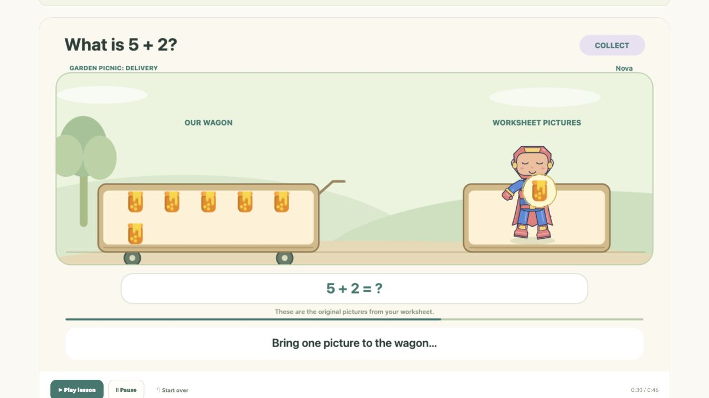

# Browser website

[Project overview](../README.md) · [Setup options](../docs/SETUP.md) · [Architecture](../docs/ARCHITECTURE.md) · [Reader notes](READER_NOTES.md)

The combined browser app provides **character creation → question entry → adult review → narrated video**. Visitors use it without Python, a local server, or an API key.

**[Open the live studio](https://my-lesson-buddy-studio.leftcloak4.chatgpt.site)** · **[Explore four narrated adventures](https://my-lesson-buddy-studio.leftcloak4.chatgpt.site/adventures.html)**



*An authored 5+2 example, captured in the live app. See the [visual tour](../docs/SHOWCASE.md) for character creation, review, photo preparation, and all four worlds.*

## Run a development copy

From the repository root, with Node/npm and Python installed:

```sh
cd web_site
npm ci
npm test
npm run build
python3 -m http.server 8610 --bind 127.0.0.1 --directory dist
```

Open **http://127.0.0.1:8610/**. Keep the terminal open for local preview. The hosted website runs independently of it. The build produces browser libraries under `dist/vendor/` and verifies all 317 current narration assets; dependencies and the model revision are pinned.

## Walk through a lesson

1. **Create a buddy.** Draw, customize parts, or import a saved character package.
2. **Bring a question.** Choose an example, upload/take a picture, or enter the numbers manually.
3. **Prepare the photo.** Compare original/prepared images and adjust paper corners or shadow reduction if needed.
4. **Check together.** Confirm the question, quantities, answer, character, object cutouts or story representation, and storyboard preview.
5. **Watch and download.** Select a story world and play the narrated actions. Keep the tab visible while recording a video.

Automatic reading is optional and experimental. Included examples have authored question data; selecting one does not prove that AI recognized it. A reader result can be corrected before review. See [supported lessons](../README.md#what-works-today) for the current 0–10 range and basic shapes.

## What the character does

| Lesson | Character action |
| --- | --- |
| Addition | Fetch, carry, and deposit new objects in the starting group. |
| Subtraction | Carry objects to a separate recipient; count the remainder. |
| Counting | Visit and point to each object once. |
| Shapes | Trace the shape gate or inspect and name its outline. |

**Garden Picnic**, **Maker Workshop**, **Ocean Discovery**, and **Moon Station** provide distinct scenery and mission narration. Automatic suggestions avoid the last prepared world when another is available. Reviewed mathematical facts and object identities remain fixed across settings.

**Gentle motion** follows the device's reduced-motion preference by default. It suppresses camera/ambient motion and celebration effects while retaining mathematical actions. The thinking pause freezes background motion. These are design choices; effects on learning or fatigue have not been measured.

Parts characters use defined hand anchors when carrying objects. Drawings move intact, with a prop anchor beside their visible artwork. The story preserves the child's drawing rather than inventing limbs. Playback, seeking, and export share the same frozen scene/audio timing.

## Match the source worksheet

After **Check our lesson**, review **The same little pictures**:

| Representation | Use it when |
| --- | --- |
| Separate original cutouts | Automatic extraction finds the expected number of clear objects. |
| One original crop, repeated | Choose **Choose one object**, crop one complete picture, then **Use this picture**. |
| Story stars | Choose **Use story stars instead**, or enter a pure number question without a picture. |

**Find separate objects** retries extraction. Changing the picture or question clears the previous approval. The included 5+2 popsicle exercise can retain seven individual popsicle cutouts with stable identities throughout the story.

Extraction is conservative local image processing for separated artwork on a light background. Mixed artwork, clipping, detached parts, black text, and noisy backgrounds can require manual cropping. It is not a general learned segmenter.

## Photograph preparation

The browser detects the paper boundary, corrects perspective, and reduces uneven lighting or soft shadows. **Prepared worksheet / Original photo** lets an adult compare them. **Adjust paper edges** supports dragging corners or entering positions; **Use original photo** restores the source. Shadow reduction can be disabled. Corrections always restart from the original image.

Capture one complete question, with visible paper corners against a distinguishable background and even light. Missing/uncertain boundaries retain the original for manual adjustment. Processing cannot recover material hidden by fingers, glare, clipping, or overlap.

**Try a photo example** is a labeled simulated photograph. Pixel fixtures exercise perspective, rotation, gradients, and shadows; these are not a real-phone benchmark. Run `node scripts/check_photo_fixtures.mjs` from this directory for the synthetic checks. [Current evaluation boundaries](../docs/EVALUATION.md) apply.

## Processing, storage, and export

| Concern | Behavior |
| --- | --- |
| Worksheet/character pixels | Processed in the visitor's browser; not uploaded to the site server or a vision API. |
| Optional model | SmolVLM-256M through WebGPU; approximately 264 MB of weights plus runtime files downloaded on first use. |
| Drafts and saved characters | Browser-local; export a `.character.zip` to keep or transfer an editable character. |
| Narration | Prerecorded Kokoro-82M `af_heart` clips, decoded into playback and recorded video. |
| Video file | MP4 when supported by the browser; otherwise WebM. Downloaded rather than permanently hosted. |

Device compatibility, available GPU memory, and cache retention vary. Reading failures lead to manual entry. Browsers without recording support may still play a lesson. Model download is an external network request; the image itself stays local. See [reader notes](READER_NOTES.md) for pinned files, validation, cancellation, and the recorded inference limitation.

## Regenerate narration or deploy

Ordinary builds use checked-in audio. Optional narration regeneration runs from the repository root:

```sh
python3 -m venv .venv-speech
.venv-speech/bin/python -m pip install -r requirements-speech.txt
.venv-speech/bin/python scripts/setup_neural_voice.py
.venv-speech/bin/python web_site/scripts/build_narration.py
```

Setup explicitly downloads about 354 MB of pinned voice/model assets to `.cache/kokoro`, verifies their hashes, and requires FFmpeg. Synthesis then runs locally on the developer's CPU. Counting clips use timings from one continuous performance; immutable filenames prevent stale audio from changing scene timing. Earlier system-voice clips remain for comparison, but the current manifest selects lesson audio. Synthetic voice naturalness has not been evaluated with children.

The built `dist/` is the website deployment artifact. In the existing Sites workspace, deployment identity remains in the local `.openai/hosting.json`, excluded from the public repository. Reuse that identity for an authorized update and record the matching source commit/archive. A GitHub push alone does not redeploy the live app. Do not deploy local caches, dependency folders, user libraries, or the research corpus with the child-facing website.

Libraries, models, and audio attributions are in [third-party notices](dist/THIRD_PARTY_NOTICES.txt).
